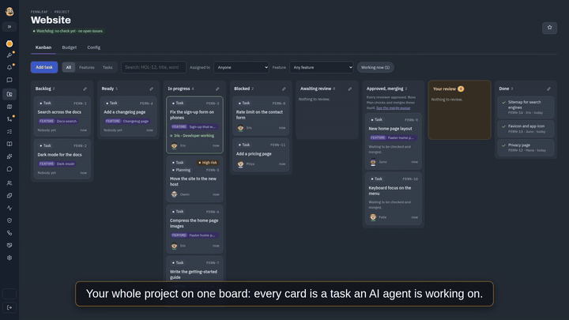

# Boss Man

Boss Man runs teams of AI agents on a machine you own. Each team is a **company**: a CEO agent plans the work, other agents pick up tickets on a board, and anything that needs you lands in one **decision queue**, so you approve and steer instead of watching every step.

It is for people who want AI agents doing real project work (code, docs, design) on their own Docker host, with their own keys, and who want to stay in charge of what gets merged and deployed.

> **Status: beta.** Boss Man works, and its own agents build it, but expect rough edges and breaking changes. Read [docs/23-updating.md](docs/23-updating.md) before each update.

## See it working



**[▶ Watch the full video (63 seconds)](https://github.com/user-attachments/assets/a239301f-dd1c-4fb4-a3f2-2a86c6a52972)**

<!-- The loop above (BOS-1554) is cut from docs/promo/boss-man-promo.mp4 and autoplays because GitHub plays animated
     images on its own, never an MP4. How both are made: docs/promo/README.md -->

A one-minute tour (63 seconds), recorded from the real app with made-up data: the board, the agents, their runs, the merge queue, a decision answered from a phone, and the roadmap.

## Install

You need a Linux host with Docker (a plain Linux box, a Proxmox VM, or TrueNAS SCALE), and a Claude subscription or an Anthropic API key, or any OpenAI compatible API key (tested so far with OpenRouter, Ollama and Synthetic). You can install from ready-made Docker images, published as pre-releases on the [releases page](https://github.com/Leonfinn/Boss_Man/releases), or build the containers from the source on your server.

> **On Proxmox, use a VM, not an LXC container.** In most LXC containers the network guard cannot load, so agents' runners could reach your home network. See [docs/32-proxmox.md](docs/32-proxmox.md).

1. With only Docker on the host, install from the ready-made images: [docs/35-install-from-images.md](docs/35-install-from-images.md). To build from the source instead, follow [docs/00-first-time-install.md](docs/00-first-time-install.md) on any host, TrueNAS SCALE included. It takes you from an empty host to a company with an agent working its first ticket.
2. On TrueNAS SCALE, [docs/06-install-truenas.md](docs/06-install-truenas.md) adds the dataset, snapshots and the optional extras.
3. Before you update, read [docs/23-updating.md](docs/23-updating.md).
4. If something goes wrong, or you want to tune memory limits, see [docs/29-tune-and-troubleshoot.md](docs/29-tune-and-troubleshoot.md).

## Get help

- **Something broken, or a question?** See [SUPPORT.md](SUPPORT.md): bugs go to GitHub Issues, questions and ideas to Discussions.
- **A security problem?** Do not post it in public. Report it through GitHub's private form, as [SECURITY.md](SECURITY.md) explains.
- **Want to contribute?** See [CONTRIBUTING.md](CONTRIBUTING.md). During the beta we take bug reports and ideas, not pull requests.

## How it works

Each company is a team of AI agents led by a CEO agent. The CEO turns your goals into tickets on the board, and the other agents pick them up and do the work.

Each company runs in its own runner. A runner is a Docker container that holds one company's agents, secrets and deploy targets.

The agents are coding tools such as Claude Code, Codex and OpenCode, running inside the runner. Boss Man drives them through the Agent Client Protocol (ACP), an open standard for controlling coding agents. Boss Man asks each agent which models it offers, so the model lists stay current.

Work is tied to objectives. An objective is a goal with key results you can measure, so you can see whether the work is getting you there.

One company can hire another through an engagement. An engagement is a formal request that sets out the scope, what to deliver, how to check it and a budget limit.

The decision queue holds everything that needs you, including blockers that have gone stale. Items that hold up the most work, or are due soonest, come first. When a card's answer promises a screenshot ("Done, screenshot attached"), paste the picture into the box under the answers (or use Attach file), then press the answer; the card won't take that answer without one, and the agent gets the picture straight away.

Each agent is paid for by a funding source, such as an API key or a subscription plan. Boss Man tracks spend against each source, including a subscription's usage limits.

Boss Man takes its inspiration from [Paperclip](https://github.com/paperclipai/paperclip). It is a separate product, written from scratch, and it does not depend on Paperclip. Compared with Paperclip, it adds:

- companies that can work with each other
- a kanban board you can change
- a decision queue, so decisions do not get lost among the tickets
- reminders for blockers that have gone stale
- monthly budgets that also track subscription usage
- model lists read from the agents, so they stay current
- a fix for Claude sign-ins expiring
- goals and a roadmap view

## Run it from source (development)

You need Node 22.12 or later and pnpm 10. The master key encrypts stored secrets, so keep the same one between restarts.

```sh
pnpm install
mkdir -p secrets && openssl rand -base64 32 > secrets/master.key
BOSSMAN_MASTER_KEY_FILE="$PWD/secrets/master.key" BOSSMAN_INSECURE_COOKIES=1 pnpm dev
```

In a second terminal, start the web UI. It opens on http://localhost:5173 and sends API calls to the server on port 3100:

```sh
pnpm dev:web
```

Without `DATABASE_URL` the server keeps its data in an embedded Postgres (PGlite) under `apps/server/data/`. For a real install, use Docker Compose as the install guide describes.

[CLAUDE.md](CLAUDE.md) holds the working rules for the AI agents that build Boss Man. It is not a guide for people.

## Documents

**Running Boss Man.** Read these in order: install, then update, then the extras you need.

| Doc | What's in it |
|---|---|
| [docs/00-first-time-install.md](docs/00-first-time-install.md) | Start here to install: from an empty Linux host (or TrueNAS SCALE) to a company with an agent working its first ticket |
| [docs/06-install-truenas.md](docs/06-install-truenas.md) | TrueNAS SCALE: the dataset, snapshots, blue/green, and the TrueNAS steps for the host deployer, HTTPS and the feedback portal |
| [docs/32-proxmox.md](docs/32-proxmox.md) | Running Boss Man on Proxmox: use a VM, not an LXC container, and why |
| [docs/23-updating.md](docs/23-updating.md) | Read before you update: the update steps, backups and how to check one restores, breaking changes that need a hand step, and where release notes are |
| [docs/29-tune-and-troubleshoot.md](docs/29-tune-and-troubleshoot.md) | Fixes for common problems, where backups are saved, memory limits, reserved threads and Synthetic |
| [docs/30-in-app-updates.md](docs/30-in-app-updates.md) | Updating from the web page: setting up the host deployer on any Linux host, with TrueNAS notes |
| [docs/24-privacy.md](docs/24-privacy.md) | What Boss Man sends, and where |
| [docs/20-https-tailscale.md](docs/20-https-tailscale.md) | An HTTPS address through Tailscale Serve, which the installable web app and phone notifications need |
| [docs/31-phone-notifications.md](docs/31-phone-notifications.md) | Pages and asks on your phone through your own ntfy server, with Approve buttons |
| [docs/33-public-portal-cloudflare.md](docs/33-public-portal-cloudflare.md) | The feedback portal on a public address through a Cloudflare Tunnel, with no router port opened |
| [docs/34-check-workers.md](docs/34-check-workers.md) | Check workers: more machines on any Docker host to take quick and merge checks when the check line is long |
| [docs/12-runner-add-ons.md](docs/12-runner-add-ons.md) | Optional tools in the runner image, such as a browser |
| [docs/15-penpot.md](docs/15-penpot.md) | The optional Penpot design tool |
| [docs/16-penpot-agent-setup.md](docs/16-penpot-agent-setup.md) | Letting agents read and draw designs in Penpot |
| [docs/17-watchdog.md](docs/17-watchdog.md) | The Scrum Master watchdog, which checks each board for problems |
| [docs/11-import-export.md](docs/11-import-export.md) | Moving a company in or out of Boss Man as one file |
| [docs/14-paperclip-migration.md](docs/14-paperclip-migration.md) | Moving a company over from Paperclip |
| [docs/21-move-to-new-host.md](docs/21-move-to-new-host.md) | Moving Boss Man to another Docker host: what moves, hard-coded host values, cut-over order, rollback, with TrueNAS and Proxmox notes |
| [docs/22-staging.md](docs/22-staging.md) | A second, separate staging stack: setup, one-step deploy of a commit, rollback, smoke checklist, what it does not cover |
| [docs/09-self-deploy.md](docs/09-self-deploy.md) | Boss Man updating itself: the host deployer, the runner drain, the leader lock and blue/green swaps |
| [docs/27-netguard.md](docs/27-netguard.md) | The runner network guard, which stops agents reaching your home network, and how to turn it off |

**For contributors.** How Boss Man is built and checked, and the project's own planning records. They mention internal ticket numbers (BOS-…) and "the owner", the person who runs a Boss Man install.

| Doc | What's in it |
|---|---|
| [docs/02-architecture.md](docs/02-architecture.md) | Components, the runner model, the data model, the decision queue, engagements, budgets and secrets |
| [docs/10-migrations.md](docs/10-migrations.md) | The rules for database migrations and server code that keep a rollback safe |
| [docs/28-browser-checks.md](docs/28-browser-checks.md) | How to check UI work in a browser, on a real address and on a phone |
| [docs/18-website.md](docs/18-website.md) | The public website in `apps/site`: how it is built and checked |
| [docs/25-published-images.md](docs/25-published-images.md) | How the ready-made images are built, published, signed and released |
| [docs/26-skill-proposals.md](docs/26-skill-proposals.md) | How a skill the CEO proposes is reviewed before the owner decides |
| [docs/19-workflow-retros.md](docs/19-workflow-retros.md) | Workflow retros: finding where work goes wrong between agents and proposing one change at a time |
| [docs/01-scope.md](docs/01-scope.md) | Planning record: the problem, goals, non-goals and requirements, plus the v1, v1.1 and later scope |
| [docs/03-phased-plan.md](docs/03-phased-plan.md) | Planning record: spikes first, then the build phases to v1, and the plan for Boss Man to build itself |
| [docs/04-research.md](docs/04-research.md) | Planning record: findings with sources on the Paperclip code, Claude authentication and policy, ACP, and quota tracking |
| [docs/05-decision-log.md](docs/05-decision-log.md) | Planning record: every scoping decision and its answer |
| [docs/07-feature-requests.md](docs/07-feature-requests.md) | Planning record: feedback notes, features, scoring and the public feedback portal |
| [docs/08-v1.2-plan.md](docs/08-v1.2-plan.md) | Planning record: the runner launcher, the setup wizard, merge checks, pull requests, the Agents page and more |
| [docs/13-team-plan.md](docs/13-team-plan.md) | Planning record: the CEO proposing a team for a project |

## Licence

Apache-2.0. See [LICENSE](LICENSE).
