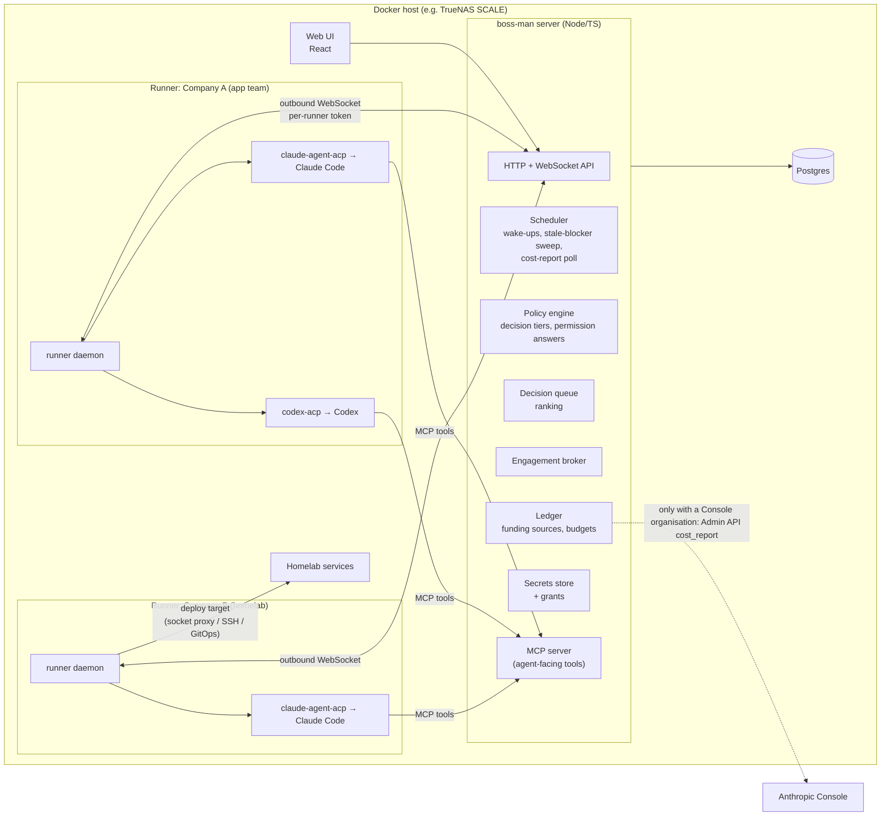
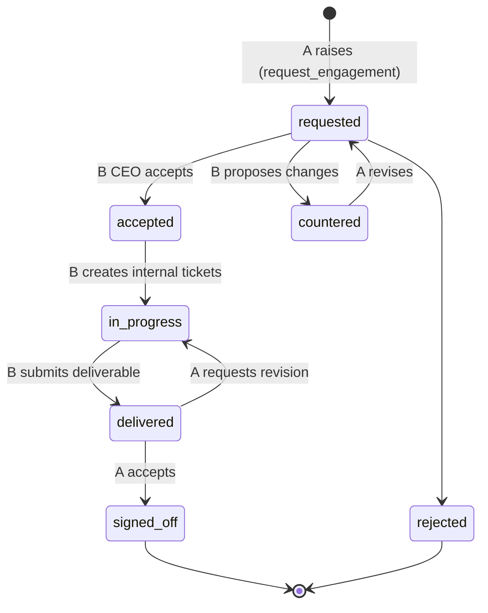

# 02 — Architecture

This is the architecture as built. The spikes S1–S3 in [03-phased-plan.md](03-phased-plan.md) settled the open questions. The data model below is a sketch: the full tables are in `apps/server/src/db/schema.ts`.

## Components



### Server (`boss-man`)
- **Stack:** a TypeScript Node server, Postgres and a React UI. One Compose stack.
- **Owner authentication:** a single owner account with local login. Remote access is assumed to go through Tailscale or the LAN.
- **Scheduler:**
  - wakes agents on a schedule or when an event arrives (a ticket is assigned, a blocker is resolved, a decision is answered);
  - runs the stale-blocker sweep;
  - optionally polls the Admin API cost report (later, once a Console organisation exists).
- **Policy engine:** evaluates the rules for the decision tiers and answers ACP permission requests.
- **MCP server:** the only way agents reach Boss Man (Streamable HTTP). Each agent session gets a token that is limited to its own company and agent.

### Runners (one per company)
- **What's in the image:**
  - **no Anthropic code** (DR-050): Claude Code and its ACP adapter are installed on first start (below), so the image can be published;
  - Codex and `@agentclientprotocol/codex-acp`;
  - OpenCode (`opencode-ai`, MIT);
  - a small **runner daemon**.
- **The Claude pack (DR-050, BOS-972):** `apps/runner/claude-pack/` pins `@anthropic-ai/claude-code` and `@agentclientprotocol/claude-agent-acp` with a committed lockfile. A one-shot installer container (the runner image, another command) runs `npm ci` into `/opt/bossman-claude/<lock hash>` on the `bossman-claude` named volume, checks `claude --version`, runs the canary, then writes a `READY` marker; only a ready folder is used. The launcher runs it before starting a runner (and the compose `claude-pack` service does the same for hand-started runners); the runner mounts the volume **read-only** and points `CLAUDE_CODE_EXECUTABLE` at the ready pack, with the adapter from the pack too. Without a ready pack the runner reports Claude Code absent (Claude agents say so), and Codex and OpenCode keep working. Folders are content-addressed, so an update installs beside the old one and a rollback just picks the old folder.
- **Connection:** the daemon **dials out** to the server over WebSocket using a per-runner token. A runner can therefore run on a different host from the server without any inbound ports.
- **Work:** it starts and manages ACP sessions over JSON-RPC on stdio, one session per agent task. It streams events back to the server: messages, tool calls, `usage_update`, permission requests, and `rate_limit_event` if spike S1 shows it is available.
- **Workspace:** each company has its own volumes. Secrets are injected at runtime from that company's grants and never written into the image.
- **Rebuilds:** the image is rebuilt by hand, roughly weekly, to pick up new releases (R9); nothing rebuilds it on a timer. `scripts/update-runner.sh` builds a candidate and runs a canary in it with networking off: a real Codex and OpenCode session against stand-in models, each with one permission-checked tool call, and each inside the agent fence where the host has one (BOS-321); a Claude session is proven by the pack installer instead (it runs the same canary once it has the pack). Only a passing build replaces `boss-man-runner:current`; the one before is kept as `:previous` for `--rollback` (R52). The runners then move onto it without cutting off runs in progress (see [09-self-deploy.md](09-self-deploy.md), "Phase 2"). With the launcher (R55), the server asks a small launcher container to start, stop and swap each company's runner.
- **Spike S2 settled these details** (see `spikes/s2-acp/README.md`):
  - **Installing Claude Code:** Anthropic's npm package `@anthropic-ai/claude-code`, installed by the pack on first start (DR-050) rather than baked into the image. `CLAUDE_CODE_EXECUTABLE` points the adapter at it rather than its own bundled copy. `DISABLE_UPDATES=1`.
  - **Codex approvals:** Codex must start in `INITIAL_AGENT_MODE=workspace-write`. Its default `agent` mode sends approvals to Codex's own AI reviewer instead of Boss Man.
  - **Codex sandbox:** superseded by the agent fence (DR-004, below). Codex's own bubblewrap sandbox can't start in a runner container (user namespaces are blocked; BOS-315 proved it fails outright), and loosening seccomp for it would weaken the whole container. A shell call fails in Codex's sandbox until the model asks to escalate it, which raises a permission request to Boss Man; the escalated command then runs inside the agent fence.
  - **Denials:** Codex ends the turn when a permission is denied, while Claude continues. The decision flow re-wakes Codex agents with the answer.
- **Agent fence (DR-004).** A run started with `fence` (the company setting arrives with Sandbox 5) runs its adapter, and so everything the agent starts, inside a Landlock fence applied by `apps/runner/src/fence/landlock.pl` (BOS-321). Landlock is unprivileged and allowed by Docker's default seccomp since 20.10.18; the runner needs no extra capabilities.
  - **What a session may write:** its working folder, its own home (`<runner data>/agents/<agentId>`: HOME, Claude/Codex/XDG folders) and a temp folder per run in it, the pnpm store, check-all's queue folder (`<workspaces>/.bossman-coord/queue`), and the project's shared Claude memory. check-all's stored results and pair proof (`.bossman-coord/gate`) are read-only to it: only the runner and its merge check write them, so an agent can't switch on two checks at once. An agent can still disrupt the queue (hold a slot, plant entries) or fool a check it runs by hand; the merge check never reuses a stored result, so neither changes what merges. Of the shared bare repo, for a worktree only what a commit writes (`objects`, `refs`, `logs`, its worktree's admin folder), never its `config` or `hooks`; for a ticket's own clone (below), nothing.
  - **What it may read:** system folders, the runner app, the npm prefix and browsers, its skills and the shared repo. Not other tickets, other agents' homes, the shared `~/.claude`, the runner's data or `/run/secrets`. With Landlock ABI 6 it also can't signal or reach the sockets of other sessions or the runner.
  - **Self-test:** at start-up the runner reports its Landlock ABI and level (`full` from ABI 6, `partial` from 2, else `unavailable`) as `runner.sandbox`, stored on the runner. A run asked to be fenced on an unavailable runner starts unfenced and says so.
  - **The merge check:** `workspace.verify` with `fence` runs the check the same way, with its own home (`<runner data>/agents/merge-check`) and a temp folder per check (BOS-323). Unasked, or on an unavailable runner, it runs as before; the reply's `fenced` says which.
  - **Not covered yet:** network addresses (netguard, Sandbox 4) and credentials in the agent's environment (Sandbox 2).
- **The runner's own git (BOS-326, BOS-332).** The runner runs git itself (checkpoints, review copies, diffs, releases, merges, fetches and pushes with the company's git token), and a repo's config can name programs git then runs inside the runner. So every such call, in `apps/runner/src/workspace.ts`:
  - **Config allowlist:** `GitConfigGuard` (`git-config-guard.ts`) reads the shared repo's `config` (`git config --no-includes --list`, which runs nothing) and removes any key not on a short allowlist (core basics, `remote.origin.url/fetch`, `branch.*.remote/merge`, `user.*`, `bossman.ticket-*.base`, a few `gc.*`). Each removed key is logged by name. If one can't be removed the call is refused. It is an allowlist because most dangerous keys are wildcards (`filter.<x>.clean`, `diff.<x>.textconv`, `merge.<x>.driver`, `url.<x>.insteadOf`, `include*.path`) that no per-key override can cover. Agents' own settings in the shared config (aliases, `pull.rebase`) are removed too; to keep one, add it to the allowlist.
  - **Ticket clones (BOS-323):** a call in a ticket's own clone checks that clone's `config` against the same allowlist (plus `remote.shared.url/fetch`), so a filter planted there is removed before the runner's git runs, fenced or not. New clones get the recorded address as `origin`, not the shared config's.
  - **No pointers an agent can change:** bare-repo calls get `GIT_DIR`; calls in a worktree get `GIT_DIR` (the admin folder, found from the repo's side), `GIT_COMMON_DIR` and `GIT_WORK_TREE`, so the folder's `.git` file is never read. git 2.39's ref store still reads the admin folder's `commondir`, so one that doesn't lead back to the repo makes the call fail rather than be followed. In a clone (a real `.git` folder, not a symlink) `GIT_DIR` and `GIT_COMMON_DIR` are both that folder, so a planted `.git/commondir` is ignored.
  - **Second layer, for a key planted between the check and the run:** no global or system config, `core.hooksPath=/dev/null`, `core.fsmonitor=false`, an empty `credential.helper`, `commit.gpgSign=false`, no askpass program, `GIT_SSH_COMMAND=ssh`, and diffs with `--no-ext-diff --no-textconv`.
  - **Pinned remote:** fetches and pushes go to the address the runner recorded in `repos/<project>.url` (outside the repo, written on clone and every ensure), never to `origin`, so a planted URL can't send the token elsewhere. A repo older than this uses its config's single `remote.origin.url` until its next ensure, and logs that.
  - **Limits:** without the fence an agent runs as the same user as the runner and can re-plant a wildcard key in the moment between the check and the git run; the fence (the config is read-only to a fenced session) and per-ticket clones (Sandbox 3) close that.
- **Ticket copies (BOS-323).** A ticket's copy (`tickets/<id>`, and a reviewer's `reviews/<id>`) is either a worktree of the project's shared bare repo (a `.git` file) or the ticket's own clone that borrows the shared repo's objects read-only (a `.git` folder). A clone keeps its branches, config and hooks to itself, so one ticket can't delete another's branch or plant config the runner later runs for another. Every operation handles both; `BOSSMAN_TICKET_COPIES=clone` makes new copies clones and turns an existing worktree into one in place at its next run (every file kept; staged changes become unstaged).
- **Fresh origin in copies (BOS-853).** Each run start in an existing copy (and each review run) fetches the shared repo from upstream, branches and tags, under the repo lock: one upstream fetch per run, cut off after 60 s (`RUN_START_FETCH_TIMEOUT_MS`, git's helpers killed with it) so a hung link can't hold up the project's other runs and merges; on failure the run starts with what it has and logs one `couldn't refresh project` line. A clone then gets `origin/*` and the tags from the shared repo. A session's git is given `url.<repo>/bossman-origin.insteadOf=<upstream>` (a read-only view of the shared repo's origin refs, rebuilt by the daemon after each fetch) and a `pushInsteadOf` to a path that is no repo, through GIT_CONFIG_* env only, so the agent's `git fetch` needs no login and pushes go nowhere. In a worktree copy that fetch writes into the shared repo, which a fenced session can't, so a fenced agent there relies on the run-start refresh.
  - **Sync:** the runner fetches the clone's `bossman/<id>` branch, turn checkpoints and review snapshot (only that ticket's refs) into the shared repo after every checkpoint, and before a merge, push, the carried-work and migration checks and release. If that fails the operation refuses rather than use a stale branch. Agents reach other tickets' branches read-only with `git fetch shared`.
  - **Objects:** the shared repo is set to `gc.pruneExpire=never`, so a `git gc` there never drops what a clone borrows.
  - **The runner's own git in a clone** runs inside the fence whenever the runner can fence, whatever the company's setting: a clean filter or fsmonitor in the clone's config still runs for it, so it may write only the clone, its own temp folder and index, and read the shared repo. The clone's side of a sync (upload-pack) is fenced too, and the shared repo fsck-checks what it takes. **On an `unavailable` host** that git runs unfenced, protected by the config allowlist and the second-layer overrides (BOS-332, above): only a key planted in the moment between the check and the git run gets through.
  - **Shared memory:** Claude Code keys project memory by the git root, which for a clone is the clone. The runner links `projects/<clone>/memory` to the shared repo's, in the shared `~/.claude` and in a fenced agent's home.
  - **Rollout and rollback:** an image from before BOS-323 deletes any ticket folder whose `.git` isn't a worktree pointer, so clones may only be made once every image a runner could roll back to understands them. BOS-323 ships with worktrees as the default; a follow-up switches the default to clones, and a later one removes the worktree code. Rolling back past BOS-323 after the switch would delete every clone and its uncommitted work (the branches survive in the shared repo).
- **Event delivery (R31).** Each event from the runner has a sequence number. The runner keeps a journal until the server acknowledges each event, and replays from the last acknowledged one after a reconnect. Both sides send heartbeats. Because of the Claude Code licence, the public repo **publishes the Dockerfile, not prebuilt images containing Claude Code** (see the risks in 03).

### Claude credentials (R10)
- **Default:** a `claude setup-token` one-year token, kept in the secrets store and injected as `CLAUDE_CODE_OAUTH_TOKEN`. Shared interactive logins race when they refresh (anthropics/claude-code#73576, #88583), so the setup-token is the default for any runner with agents running in parallel.
- **Alternative:** Anthropic's own login completed inside the runner, through a relayed terminal (`claude auth login --claudeai`). The resulting credentials stay in the runner's volume. Boss Man never reads them.
- **API key:** from the linked Console organisation. This draws on the $200 monthly API credit.

## Core data model (sketch)

| Entity | Key fields | Notes |
|---|---|---|
| `company` | name, mission | |
| `agent` | company, role (`ceo`/`manager`/`worker`), reportsTo, agentKind (claude/codex/…), model, fundingSource | The onboarding wizard creates a `ceo` (R18) |
| `runner` | company, status, imageVersion, lastSeen | |
| `objective` | company, project?, title, priority, status | |
| `key_result` | objective, metric, target, current, method (`manual`/`agent`/`check`), checkSpec | |
| `milestone` | objective, title, targetDate | |
| `project` | company, name, workflow | |
| `workflow_column` | project, name, systemState, order, wipLimit | Each column maps to one of 6 system states |
| `ticket` | project, milestone?, keyResult?, systemState, columnId, assignee (agent/owner), dueDate (derived/override), customFields JSONB | |
| `ticket_dependency` | blocked, blockerTicket? **or** blockerEngagement? **or** blockerDecision? | One table models every kind of blocker |
| `decision` | company, kind (`question`/`approval`/`permission`/`stale_blocker`/`stalled_run`/`engagement`/`budget`), question, options[], recommendedOption, raisedBy, tier, status, answer, answeredBy | |
| `engagement` | requesterCompany, requesterProject, providerCompany, scope, deliverables, acceptanceCriteria, budgetCapCents, status | |
| `engagement_message` | engagement, fromCompany, body, attachments | The only channel between companies |
| `run` | agent, ticket?, engagement?, acpSessionId, startedAt, endedAt, model, outcome | |
| `cost_event` | run, fundingSource, tokens, estimatedUsd, chargedToProject | |
| `quota_sample` | fundingSource, window (`five_hour`/`seven_day`/…), usedPct, resetsAt, source | |
| `funding_source` | kind (`api_credit`/`subscription`/`usage_credits`/`api_payg`), provider, cycleAnchorDay, monthlyGrantCents | |
| `budget_policy` | scope (company/project/agent/instance), fundingSource, window, limit, onLimit (`ask`/`pause`) | |
| `secret` | name, ciphertext, version, owner | Encrypted with envelope encryption; the master key comes from a file or env var |
| `secret_grant` | secret, company, envName / mountPath, deployTarget? | Points to the secret; it is not a copy |
| `secret_access_log` | grant, run, at | |
| `deploy_target` | company, kind (`ssh`/`docker`/`git`), endpoint, grantIds, rules, prodFlag | |
| `policy_rule` | company?, trigger, condition, outcome (`allow`/`ceo`/`owner`/`deny`) | |

Agents never see status names. They see the meaning of the system states through the MCP tool descriptions, for example `set_ticket_state(state: "review")`. A project's custom columns are labels for people only.

## Decision queue

**Ranking score.** The score has three parts, and each part is shown in the UI so the order can be explained:

```
score = W_block * Σ (priority_weight(objective of t))  for t in tickets transitively blocked
      + W_due   * urgency(min dueDate of blocked tickets)   // e.g. 0 if none, rising as the date nears or passes
      + W_age   * log(1 + hours since raised)
```

**Sources of rows:**
- `raise_decision` calls from agents. A recommended option is **required**.
- Escalations from the policy engine.
- ACP permission requests that fall outside the rules.
- Engagement offers that need the owner's approval.
- **Stale-blocker rows** from the sweep.

**Stale-blocker sweep.** Every minute (`BOSSMAN_SWEEP_MS`), it looks for any open blocker that has dependents and no activity for longer than the threshold (24 hours by default). It creates or updates **one** `stale_blocker` decision for each blocker. The decision offers three choices: *chase* (wake the assignee with a nudge), *reassign*, or *drop the dependency*.

**Answering a row.**
- It is answered in place. A "yes" accepts the recommended option.
- The answer wakes the agent that asked.
- Any ticket that was waiting on the decision moves forward automatically.

## Engagement lifecycle



- **Owner approval:** the owner can be required to approve at `requested` (a policy rule) and at `delivered`, for example for production deploys.
- **Blocking across companies:** Company A's dependent tickets carry a `ticket_dependency` on the engagement. They unblock at `signed_off`.
- **Costs:** Company B's runs carry the `engagementId`. Their `cost_event`s are charged to Company A's project. When the budget cap is reached, the engagement pauses and a decision row is created.

## Budgets and quota
- **API credit:**
  - **Spend (v1):** the sum of each run's reported cost (ACP `usage_update.cost`, or `total_cost_usd`) for agents on the API-key funding source, since the billing-cycle anchor. Remaining credit is the monthly grant minus that sum. Anthropic documents no balance endpoint, and the Admin API is unavailable for individual accounts (spike S3). The UI says spend outside Boss Man isn't included, and links to the Console Cost page.
  - **Spend (optional later):** with a Console organisation and an admin key, poll `GET /v1/organizations/cost_report` hourly and reconcile it against Boss Man's own records.
  - **Before data arrives:** run-level `total_cost_usd` estimates cover the gap until the report catches up.
- **Claude quota:**
  - **If spike S1 succeeds:** `rate_limit_event` data gives the 5-hour and 7-day used percentages and reset times.
  - **Otherwise:** usage is estimated from tokens and labelled as an estimate.
  - **Throttling:** low-priority agents are paused when a window passes its threshold.
- **Codex quota:** read through the Codex app-server, using `account/rateLimits/read` and the `account/rateLimits/updated` notifications.
- **Enforcement:** pre-dispatch checks against each `budget_policy`. A soft limit raises a decision row. A hard limit pauses the scope.

## Security notes
- **Network:** no inbound ports are needed on runners. The server is reached only over the LAN or Tailscale.
- **Secrets:**
  - They are encrypted at rest, granted per company, and logged at each use.
  - They are never placed in prompts or transcripts.
  - Values are redacted in run logs.
- **Isolation:** each company runs in its own container. An engagement never carries credentials.
- **Production access:** a deploy target that touches production goes through the policy engine. By default these go to the owner. Mounting the raw Docker socket is discouraged, because it is equivalent to root on the host.
