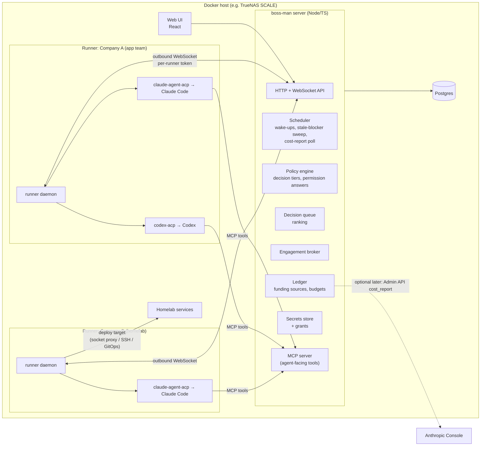
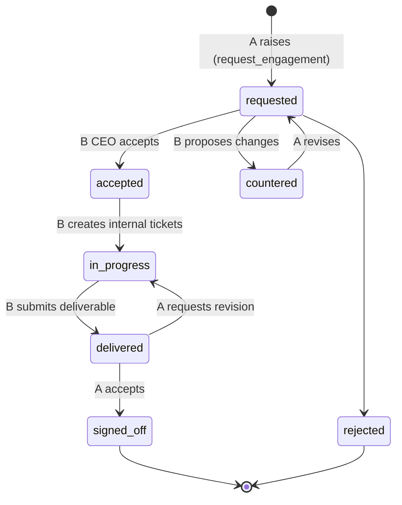

# 02 — Architecture

This is the proposed architecture. Spikes S1–S3 in [03-phased-plan.md](03-phased-plan.md) may change parts of it.

## Components



### Server (`boss-man`)
- **Stack:** a TypeScript Node server, Postgres and a React UI. One Compose stack.
- **Owner authentication:** a single owner account with local login. Remote access is assumed to go through Tailscale or the LAN.
- **Scheduler:**
  - wakes agents on a schedule or when an event arrives (a ticket is assigned, a blocker is resolved, a decision is answered);
  - runs the stale-blocker sweep;
  - optionally polls the Admin API cost report (later, once a Console organisation exists).
- **Policy engine:** evaluates the rules for the decision tiers and answers ACP permission requests.
- **MCP server:** the only way agents reach Boss Man (Streamable HTTP). Each agent session gets a token that is limited to its own company and agent.

### Runners (one per company)
- **What's in the image:**
  - the **official Claude Code**, installed with Anthropic's installer;
  - `@agentclientprotocol/claude-agent-acp`, with `CLAUDE_CODE_EXECUTABLE` set to that binary;
  - Codex and `@agentclientprotocol/codex-acp`;
  - a small **runner daemon**.
- **Connection:** the daemon **dials out** to the server over WebSocket using a per-runner token. A runner can therefore run on a different host from the server without any inbound ports.
- **Work:** it starts and manages ACP sessions over JSON-RPC on stdio, one session per agent task. It streams events back to the server: messages, tool calls, `usage_update`, permission requests, and `rate_limit_event` if spike S1 shows it is available.
- **Workspace:** each company has its own volumes. Secrets are injected at runtime from that company's grants and never written into the image.
- **Rebuilds:** the image is rebuilt weekly and on demand, to pick up new releases (R9).
- **Spike S2 settled these details** (see `spikes/s2-acp/README.md`):
  - **Installing Claude Code:** use Anthropic's npm package `@anthropic-ai/claude-code`, which installs the same native binary as the standalone installer. Set `CLAUDE_CODE_EXECUTABLE` so the adapter uses it rather than its own bundled copy. Set `DISABLE_UPDATES=1`.
  - **Codex approvals:** Codex must start in `INITIAL_AGENT_MODE=workspace-write`. Its default `agent` mode sends approvals to Codex's own AI reviewer instead of Boss Man.
  - **Codex sandbox:** Codex's bubblewrap sandbox needs user namespaces. Runner containers need a custom seccomp profile that allows them. This is verified with `seccomp=unconfined`, but a narrower profile is to be written.
  - **Denials:** Codex ends the turn when a permission is denied, while Claude continues. The decision flow re-wakes Codex agents with the answer. Because of the Claude Code licence, the public repo **publishes the Dockerfile, not prebuilt images containing Claude Code** (see the risks in 03).

### Claude credentials (R10)
- **Default:** a `claude setup-token` one-year token, kept in the secrets store and injected as `CLAUDE_CODE_OAUTH_TOKEN`. Shared interactive logins race when they refresh (anthropics/claude-code#73576, #88583), so the setup-token is the default for any runner with agents running in parallel.
- **Alternative:** Anthropic's own login completed inside the runner, through a relayed terminal (`claude auth login --claudeai`). The resulting credentials stay in the runner's volume. Boss Man never reads them.
- **API key:** from the linked Console organisation. This draws on the $200 monthly API credit.

## Core data model (sketch)

| Entity | Key fields | Notes |
|---|---|---|
| `company` | name, mission | |
| `agent` | company, role (`ceo`/`manager`/`worker`), reportsTo, agentKind (claude/codex/…), model, fundingSource | The onboarding wizard creates a `ceo` (R18) |
| `runner` | company, status, imageVersion, lastSeen | |
| `objective` | company, project?, title, priority, status | |
| `key_result` | objective, metric, target, current, method (`manual`/`agent`/`check`), checkSpec | |
| `milestone` | objective, title, targetDate | |
| `project` | company, name, workflow | |
| `workflow_column` | project, name, systemState, order, wipLimit | Each column maps to one of 6 system states |
| `ticket` | project, milestone?, keyResult?, systemState, columnId, assignee (agent/owner), dueDate (derived/override), customFields JSONB | |
| `ticket_dependency` | blocked, blockerTicket? **or** blockerEngagement? **or** blockerDecision? | One table models every kind of blocker |
| `decision` | company, kind (`question`/`approval`/`permission`/`stale_blocker`/`engagement`), question, options[], recommendedOption, raisedBy, tier, status, answer, answeredBy | |
| `engagement` | requesterCompany, requesterProject, providerCompany, scope, deliverables, acceptanceCriteria, budgetCapCents, status | |
| `engagement_message` | engagement, fromCompany, body, attachments | The only channel between companies |
| `run` | agent, ticket?, engagement?, acpSessionId, startedAt, endedAt, model, outcome | |
| `cost_event` | run, fundingSource, tokens, estimatedUsd, chargedToProject | |
| `quota_sample` | fundingSource, window (`five_hour`/`seven_day`/…), usedPct, resetsAt, source | |
| `funding_source` | kind (`api_credit`/`subscription_quota`/`api_key`), provider, cycleAnchorDay, monthlyGrantCents | |
| `budget_policy` | scope (company/project/agent), fundingSource, window, limit, thresholdKind (soft/hard) | |
| `secret` | name, ciphertext, version, owner | Encrypted with envelope encryption; the master key comes from a file or env var |
| `secret_grant` | secret, company, envName / mountPath, deployTarget? | Points to the secret; it is not a copy |
| `secret_access_log` | grant, run, at | |
| `deploy_target` | company, kind (`ssh`/`docker`/`git`), endpoint, grantIds, rules, prodFlag | |
| `policy_rule` | company?, trigger, condition, outcome (`allow`/`ceo`/`owner`) | |

Agents never see status names. They see the meaning of the system states through the MCP tool descriptions, for example `set_ticket_state(state: "review")`. A project's custom columns are labels for people only.

## Decision queue

**Ranking score.** The score has three parts, and each part is shown in the UI so the order can be explained:

```
score = W_block * Σ (priority_weight(objective of t))  for t in tickets transitively blocked
      + W_due   * urgency(min dueDate of blocked tickets)   // e.g. 0 if none, rising as the date nears or passes
      + W_age   * log(1 + hours since raised)
```

**Sources of rows:**
- `raise_decision` calls from agents. A recommended option is **required**.
- Escalations from the policy engine.
- ACP permission requests that fall outside the rules.
- Engagement offers that need the owner's approval.
- **Stale-blocker rows** from the sweep.

**Stale-blocker sweep.** Every 15 minutes, it looks for any open blocker that has dependents and no activity for longer than the threshold (24 hours by default). It creates or updates **one** `stale_blocker` decision for each blocker. The decision offers three choices: *chase* (wake the assignee with a nudge), *reassign*, or *drop the dependency*.

**Answering a row.**
- It is answered in place. A "yes" accepts the recommended option.
- The answer wakes the agent that asked.
- Any ticket that was waiting on the decision moves forward automatically.

## Engagement lifecycle



- **Owner approval:** the owner can be required to approve at `requested` (a policy rule) and at `delivered`, for example for production deploys.
- **Blocking across companies:** Company A's dependent tickets carry a `ticket_dependency` on the engagement. They unblock at `signed_off`.
- **Costs:** Company B's runs carry the `engagementId`. Their `cost_event`s are charged to Company A's project. When the budget cap is reached, the engagement pauses and a decision row is created.

## Budgets and quota
- **API credit:**
  - **Spend (v1):** the sum of each run's reported cost (ACP `usage_update.cost`, or `total_cost_usd`) for agents on the API-key funding source, since the billing-cycle anchor. Remaining credit is the monthly grant minus that sum. Anthropic documents no balance endpoint, and the Admin API is unavailable for individual accounts (spike S3). The UI says spend outside Boss Man isn't included, and links to the Console Cost page.
  - **Spend (optional later):** with a Console organisation and an admin key, poll `GET /v1/organizations/cost_report` hourly and reconcile it against Boss Man's own records.
  - **Before data arrives:** run-level `total_cost_usd` estimates cover the gap until the report catches up.
- **Claude quota:**
  - **If spike S1 succeeds:** `rate_limit_event` data gives the 5-hour and 7-day used percentages and reset times.
  - **Otherwise:** usage is estimated from tokens and labelled as an estimate.
  - **Throttling:** low-priority agents are paused when a window passes its threshold.
- **Codex quota:** read through the Codex app-server, using `account/rateLimits/read` and the `account/rateLimits/updated` notifications.
- **Enforcement:** pre-dispatch checks against each `budget_policy`. A soft limit raises a decision row. A hard limit pauses the scope.

## Security notes
- **Network:** no inbound ports are needed on runners. The server is reached only over the LAN or Tailscale.
- **Secrets:**
  - They are encrypted at rest, granted per company, and logged at each use.
  - They are never placed in prompts or transcripts.
  - Values are redacted in run logs.
- **Isolation:** each company runs in its own container. An engagement never carries credentials.
- **Production access:** a deploy target that touches production goes through the policy engine. By default these go to the owner. Mounting the raw Docker socket is discouraged, because it is equivalent to root on the host.
